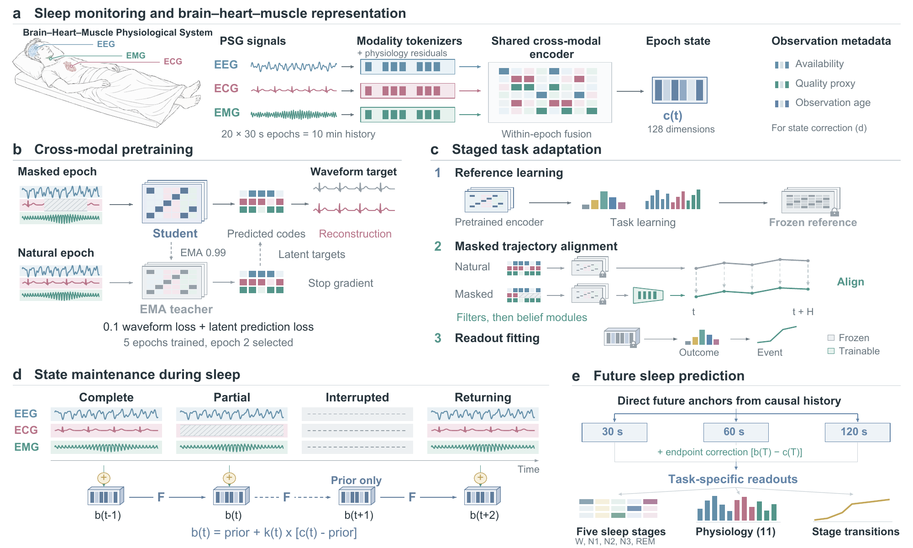

# SleepWM

**Brain–heart–muscle representation for sleep state forecasting under changing observations.**

**吴睿 · 四川大学**

## Overview

SleepWM integrates EEG, ECG and EMG into a shared physiological state representation. It combines state prediction with observation-based correction to track sleep dynamics when signals become unavailable and when observations return.

Given ten minutes of signal history, the default configuration forecasts three outcomes at 30, 60 and 120 seconds:

- **Sleep stages:** Wake, N1, N2, N3 and REM.
- **Physiology:** 11 signal-derived features spanning brain, cardiac and muscle activity.
- **Stage transitions:** the cumulative probability of at least one sleep-stage change by each forecast horizon.



The implementation connects a predict–correct state model, trajectory readout, GRU-D observation branch and reliability-aware event readout. Future predictions use state anchors corrected using the history-endpoint state estimate.

Choose the training workflow that fits your starting point:

| Workflow | Starting point | Training approach |
| --- | --- | --- |
| [Staged training](#staged-training) | A compatible fully observed reference model | Continue through the paper's partial-observation and output-adaptation stages, with stage-specific losses and freezing rules |
| [Joint supervised training](#joint-supervised-training) | Your recordings and labels | Initialize the model randomly and train the three prediction tasks together |

Both workflows use the same model components and share data preparation and evaluation tools. Joint supervised training is an alternative recipe for working with your own data; the two workflows do not imply identical trained models or performance.

## Getting started

Use Python 3.10 or later. Run the commands below from the main code directory:

```bash
cd SleepWM
python -m pip install -e .
```

Run a self-contained demonstration on CPU:

```bash
python ../example/demo.py --output-dir ../demo_output --device cpu
```

The demonstration generates synthetic recordings, prepares features, trains a small configuration, saves a checkpoint and evaluates it after reloading. It also checks that windows crossing a time gap are excluded and that held-out data use frozen training statistics. No downloads or existing checkpoints are required. Synthetic scores are software checks, not estimates of clinical performance.

## Your data

Prepare each recording as 30-second epochs sampled at **128 Hz**, with channels ordered **EEG, ECG, EMG**. Store these arrays in one NPZ file per recording:

| Array | Shape | Description |
| --- | --- | --- |
| `signals` | `[N, 3, 3840]` | Signals in **volts**, before normalization |
| `labels` | `[N]` | Integer labels: 0 = Wake, 1 = N1, 2 = N2, 3 = N3, 4 = REM; −1 = unknown |
| `modality_present` | `[N, 3]` | Boolean availability of each channel in each epoch |
| `epoch_start_seconds` | `[N]` | Actual epoch start times in seconds from a common recording origin |

Keep unknown labels and actual time gaps in the sequence. Do not renumber timestamps after excluding segments. Training windows require consecutive 30-second epochs and known labels throughout their history and forecast span. Unavailable signal values are ignored using the availability mask.

Create a CSV manifest with the following columns; the rows below illustrate the format:

```csv
record_id,subject,split,npz_path
record001,cohortA:person001,train,record001.npz
record002,cohortA:person002,val,record002.npz
record003,cohortA:person003,test,record003.npz
```

Paths may be absolute or relative to the CSV. Use a dataset prefix in subject IDs and keep all recordings from the same person in one split. Channel selection, resampling and conversion from your recording format should be completed before this step.

Data preparation creates feature caches, a prepared manifest and `statistics.json`. The prepared manifest references the original recordings, so keep them accessible. Physiological targets are automatically extracted signal features, not independent clinical annotations. Choose the preparation command for your training workflow below.

## Training

### Staged training

Use this workflow to continue from a fully observed reference model. The reference checkpoint must contain compatible `config` and `model_state` entries; an encoder-only checkpoint is not sufficient. Use the normalization statistics associated with that reference model so the signals and physiological targets remain in the same coordinate system.

```bash
python prepare_data.py --manifest ../data/manifest.csv --output-dir ../prepared \
  --statistics ../reference/statistics.json
python train.py --mode staged --list
python train.py --mode staged --stage all \
  --reference ../reference/best.pt \
  --reference-statistics ../reference/statistics.json \
  --manifest ../prepared/manifest.csv --statistics ../prepared/statistics.json \
  --output-dir ../runs/staged --device cpu
```

The stages follow these dependencies:

```text
reference → carry_align → carry_final → belief → outcome
direct → direct_event
belief + outcome + direct → fusion
belief + outcome + direct + direct_event + fusion → event
```

Carry and belief stages adapt the latent state under changing observations. The outcome stage trains its readout with the state model frozen. The GRU-D branch is trained separately; later event and fusion stages freeze their input components and train the corresponding adapters. Each stage retains its own training objective and validation-based checkpoint selection.

`--stage all` runs the eight stages and assembles `../runs/staged/combined.pt` for evaluation. To run stages individually, keep the same output directory and seed; dependencies are read from completed stages in that run. Finish with `--stage assemble`. Existing stage outputs are protected from overwriting.

Stage configuration defaults are in `sleepwm/stage_settings.json`; `--settings path/to/settings.json` applies stage-specific overrides. The complete-observation reference score is measured on your validation split for checkpoint selection. Set training duration and other hyperparameters using your validation data. `run.json` records the selected epochs and checkpoint identities.

### Joint supervised training

Use this workflow to train from random initialization. Fit normalization on the training split, then optimize the three prediction tasks jointly:

```bash
python prepare_data.py --manifest ../data/manifest.csv --output-dir ../prepared
python train.py --mode supervised --manifest ../prepared/manifest.csv \
  --statistics ../prepared/statistics.json --output-dir ../runs/sleepwm \
  --epochs 10 --batch-size 4 --device cpu
```

Training combines sleep-stage classification, physiological-feature regression and cumulative transition prediction, with simulated signal loss in the input history. The checkpoint with the lowest validation loss is saved as `best.pt`, together with its model configuration and training normalization. `history.json` records the run. Use fresh output directories for new runs.

For GPU training, select an available device explicitly; for example, on a machine with physical GPU 4:

```bash
CUDA_VISIBLE_DEVICES=4 python train.py --mode supervised --manifest ../prepared/manifest.csv \
  --statistics ../prepared/statistics.json --output-dir ../runs/sleepwm_gpu \
  --epochs 10 --batch-size 4 --device cuda:0
```

Here, `cuda:0` refers to the selected visible GPU. The same device selection applies to staged training. For supervised training, `--compact` reduces model dimensions for workflow checks; omit it for the default model configuration. `--max-batches` is for smoke tests only.

## Evaluation

```bash
python evaluate.py --checkpoint ../runs/sleepwm/best.pt \
  --manifest ../prepared/manifest.csv --statistics ../prepared/statistics.json \
  --split val --device cpu --output ../runs/sleepwm/validation.json
```

For staged training, replace the checkpoint path with `../runs/staged/combined.pt` and choose an output path in that run's directory.

The default evaluation reports stage Macro-F1, standardized physiological MAE, transition average precision and transition Brier score. Results are weighted by windows and reported for each horizon and pooled across horizons. Conditions preserve the recording's available signals or additionally remove EEG/all channels from the final four history epochs.

Prepare a held-out test split with the same frozen training statistics, then evaluate explicitly:

```bash
python prepare_data.py --manifest ../data/manifest.csv --output-dir ../prepared_test \
  --splits test --statistics ../prepared/statistics.json
python evaluate.py --checkpoint ../runs/sleepwm/best.pt \
  --manifest ../prepared_test/manifest.csv --statistics ../prepared/statistics.json \
  --split test --device cpu --output ../runs/sleepwm/test.json
```

## Code structure

```text
SleepWM/
  sleepwm/          Model components, data loading and training utilities
    stages/         Stage-specific training, freezing and validation rules
    stage_settings.json  Default settings for staged training
  figures/          Figure 1 from the manuscript
  tests/            Numerical, data and checkpoint checks
  prepare_data.py   Feature preparation and training normalization
  train.py          Select staged or joint supervised training
  evaluate.py       Evaluation using a saved checkpoint
  pyproject.toml    Package dependencies
example/
  demo.py           Self-contained synthetic-data demonstration
README.md
```

To run the checks:

```bash
python -m pip install -e ".[dev]"
python -m pytest
```

## Acknowledgements

The direct-observation branch uses GRU-D: Che et al., [Recurrent Neural Networks for Multivariate Time Series with Missing Values](https://doi.org/10.1038/s41598-018-24271-9), *Scientific Reports* (2018).
